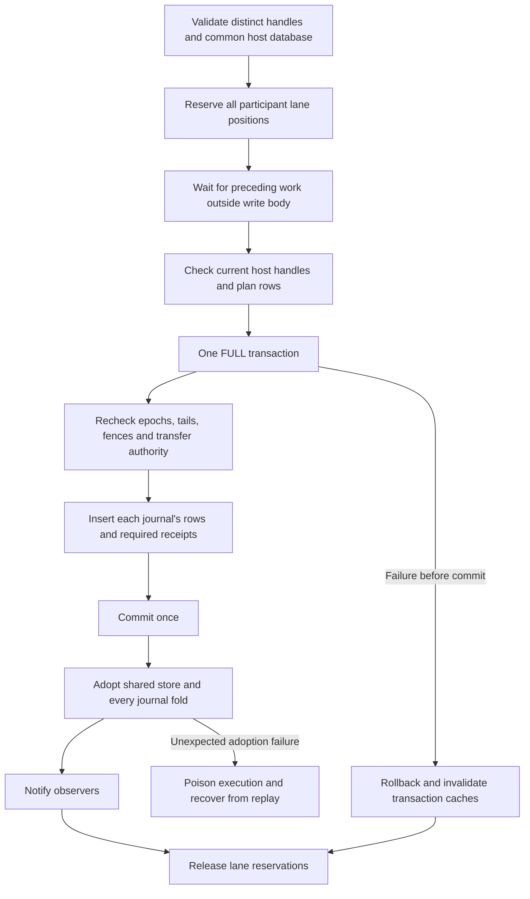
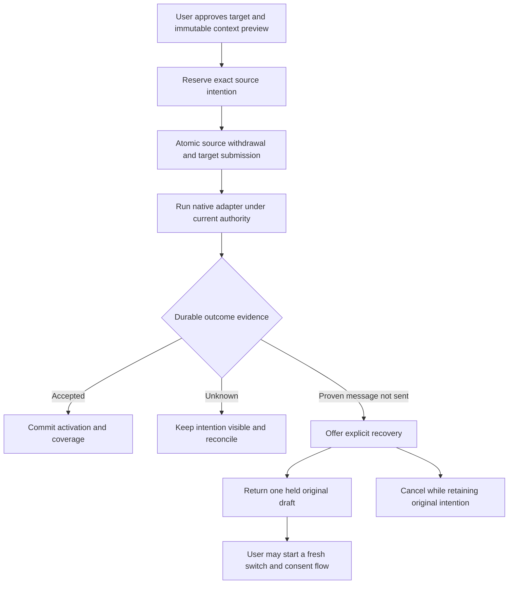

# Native conversation transfer on the journal-owned queue

Status: upstream integration is being revalidated against `b4fa75e954f1172c53abce3cbb323c17d03d401f`. The journal-owned queue port originally integrated `8f6283b32bcdefa746613e4c28d04bb1fe954eb9`; its ownership and no-resend constraints remain in force. The earlier feature checkpoint is `0e890a8d487224130c28cdd072f2a8a97f40539d`. Its passing tests do not establish compatibility with this queue migration. See the [verification matrix](native-conversation-switching-verification.md) for acceptance evidence and remaining gates.

## Ownership and invariants

The journal event stream and its queue fold own live queued cards. The legacy `queued_messages` table is an import source, not a second live queue. Conversation metadata records immutable provenance, retained evidence and transfer ownership; it must not independently update a card's current state.

A cross-session transfer has one durable commit point. That commit includes:

- The exact source body/options version and its retained origin reference.
- A source queue withdrawal and an ordinary target submission.
- The transfer binding, attachment claims and required provenance.
- One shared store receipt for all affected record mutations.

The target submission does not use the source card's `queuedMessageId`. That field describes a handoff within one journal, not a transfer between journals.

No native user-turn write may precede the durable target append. An uncertain delivery must not restore the source as sendable. A notification failure after commit is not a rollback and is not permission to send again.

## Compound journal admission

A compound operation reserves positions in all affected journal lanes in one synchronous admission step. Each position follows work already admitted to that lane. Later ordinary writes and ordered reads wait behind the reservation. Unrelated journal lanes can continue.

Waiting occurs outside the synchronous write body. The owned body must not await provider work, filesystem operations or another journal lane. A drain followed by an unguarded write is not a lock.

Each journal keeps its own epoch, sequence allocator and reducer. The transaction compares the durable tails with the planned tails. All participants must use the same actual database connection, including store and metadata receipts.

Private prepare/write/adopt/notify phases support this operation without exposing unguarded public row writers. Ordinary single-journal writes retain their ordering and durability contracts. All folds and store state are adopted before any observer can read the result.

An unexpected postcommit adoption failure blocks execution of already-admitted callbacks as well as new work. Merely closing admission would allow those callbacks to use stale state. A notification-only error after complete adoption must not undo the committed operation.

Compound operations use the host's current journal handles. They do not evict a live owner when another read/replay view opens. Existing host close/drain/reopen ordering remains authoritative.

## Provenance, import and retention

Version-4 queue facts are generationless. Their journal fence is not evidence that the current native acquisition authored the queued text. Queue admission and body edits therefore retain their own checked origin and exact body-version evidence. Import and restatement preserve that evidence and the original admission time; they must not relabel an older draft as a new-context request.

Queue facts are not provider effects. They must not taint a pending native publication or appear as already-delivered conversation turns. In particular, an unselected unsent draft must not leak into a context envelope. Canonical queue rows remain retained where required even when transcript selection excludes them.

Ordinary standalone queue actions are a separate boundary from context transfer. A session with no current or historical conversation enrollment keeps upstream `/clear` carry/Resume behavior. Known draft origin must still match the original record birth, provider, location and account; unknown legacy origin stays unknown. The ordinary action does not rewrite provenance. Transfer/source selection and recovery keep the strict boundary check, so later enrollment cannot make an old-context or unknown draft eligible for transfer. Historical feature membership without a current participant is not a standalone bypass.

Migration removes legacy-row foreign-key coupling before import can delete those rows. Known origin stays known; unknown historical origin stays unknown. A live transfer pins the exact selected version, not whichever edited version happens to be current later. Reads check byte bounds and identity before allocating or parsing retained body/options data.

Native row references and legacy-only retained originals need explicit owners and cleanup. Live cards, active transfers and archive references protect their evidence. Unreachable edit/restatement references must not accumulate as a second permanent history store.

## Transfer and recovery workflow

A generic rejection, missing receipt, timeout or aborted signal is not proof that a message was not sent. A transfer-specific proof must bind an actual guaranteed pre-write boundary to the exact submission, dispatch attempt, context, native generation and transfer binding. Accepted evidence wins over stale recovery evidence. Provider options may have changed before the refusal, so the UI must not claim that nothing happened.

This port supports **Return held draft** and **Cancel while retaining the intention**. It does not directly reset a rejected target submission to pending. A fresh switch after an explicit return uses fresh preparation and consent instead of silently reusing an old payload, native identity or option selection.

Return rechecks the immutable original and no-write proof, retires the old target attempt, restores exactly one held source card, releases the old source reservation and records recovery in one compound transaction. It does not Send or Resume the restored card. Repeating the same recovery request must return the same outcome.

Unknown delivery exposes read-only retained information and Reconcile, not a resend or return action. Retained intentions remain discoverable after cancellation and restart. Preview truncation must be explicit; the server's exact retained evidence, not the preview supplied by a client, is recovery authority.

## Clear and mixed-version clients

Clear uses the same participant-lane ordering and one shared store receipt. It advances the conversation generation and gates old intentions across every participant, including parked agents. A card's presentation hold is not enough: direct send, queue drain, continuation and explicit recovery must all enforce the original generation.

If clear wins a race with recovery, the old recovery request is refused. It must not copy the old intention into the new generation. If recovery wins, clear observes and gates its restored held card. Late native acceptance prevents a stale no-write recovery from succeeding.

Recovery has a separate negotiated capability because existing conversation snapshots use strict schemas. Hosts omit the new field for clients that do not advertise it. Mutation requires the existing full conversation capability, the recovery capability and normal ownership checks. An omitted action is unsupported, not a signal to try a fallback RPC.

Retained-intention reads use bounded pages and bounded previews. Older clients keep their original response shape; read-only clients cannot mutate recovery state.

## Verification boundaries

Required regressions include overlapping/reversed compound requests, ordered reads, cancellation and close/drain, durable epoch/tail mismatches, rollback at every write/receipt stage, postcommit failure and replay, legacy import failure/retry, edited-original retention, generationless queue provenance, all-participant clear, unknown versus proven pre-write refusal, idempotent held return, and recovery racing clear or acceptance.

After these boundaries pass, repeat all six directed native-adapter transitions, repeated revisits, large-history coverage, client compatibility, localization and full project checks on the integrated commit. Scripted native peers do not establish authenticated provider behavior or model quality. Graphical/platform and performance gates remain separate; no result from the previous baseline substitutes for them.
