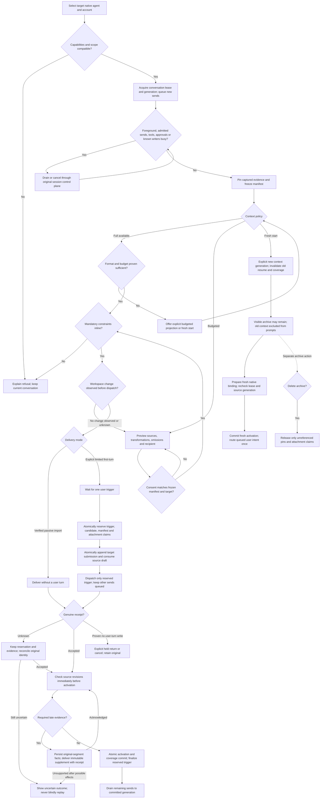
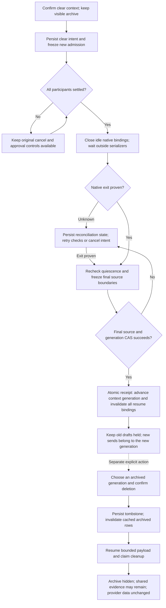

# Native conversation switching

Status: implementation in progress. Durable conversation tabs and desktop switch controls are implemented; remote/mobile compatibility and clear/archive lifecycle have automated coverage, while final integration gates remain open. The feature is not yet advertised as ready. No account-backed native transition has been verified. Earlier rendered tests reached agent selection after capability advertisement was connected, but exposed a conversation-tab publication defect. Fresh local and remote mirror regression tests cover its repair. A later environment produced Electron bundles but could not start its isolated display. No complete rendered switch journey has passed. See [capability evidence](native-conversation-switching-capabilities.md) and the [39-case verification matrix](native-conversation-switching-verification.md) for current limits.

The intended feature keeps one visible conversation while the next request runs in Claude Code, Codex or OpenCode. Each participant retains its own provider session, account, permissions and native runtime. Returning to an earlier agent creates a new activation segment and transfers source-backed context changes; historical tool calls are never executed as a transcript replay.

The upstream queue migration is specified in the [journal-owned transfer design](native-conversation-journal-queue-design.md). Integration and its new acceptance checks remain in progress. See [failed-transfer recovery](native-conversation-transfer-recovery.md) for retained originals, held return and mixed-version limits.

## Current production limits

This implementation remains experimental. The available transfer policy is explicit budgeted delivery with a first user turn.

- Production does not provide a verified model budget or token estimator. The Full delivery control is disabled, and direct requests refuse preparation instead of guessing available capacity. Budgeted delivery still requires explicit preview consent and does not promise native token fit.
- The integrated `fresh` transfer policy is unavailable. Use the separate clear-context operation before selecting another agent for a new context generation.
- Native contract checks recognize only Claude Code 2.1.309, Codex 0.159.0-alpha.3 and OpenCode 1.19.4. Other versions remain unverified.
- Budgeted projection replaces supported tool-output fields with source-backed retrieval references. It does not create a semantic summary of decisions or identify active instructions.
- Select an explicit target model and matching execution settings before recipient approval. An unreported default model, or an observed execution option that differs from the saved selection, is refused before transfer. This avoids changing the consented target proof when native defaults are recorded later. Ordinary native sends are unchanged. Do not blindly replay an uncertain turn.
- Nontext triggering messages remain unsupported by the native delivery verifier. Retained attachment ownership does not establish successful attachment delivery.
- Conversation tabs preserve their existing title and color. Rename, color and pin editing, and native/CLI session-transfer menu actions are unavailable for these tabs. Use the conversation Agent selector instead.
- Conversation keyboard cycling waits until the authoritative tab-group selection is available. It does not guess an active tab during layout hydration.

The first rendered tests exposed integration defects. Passing storage, controller or adapter tests alone does not establish a successful user journey. See the verification matrix before using this branch.

## Intended workflow

This diagram is the implementation contract, not a claim that every path is implemented.

Waits for provider work occur outside session serialization and database transactions. Cancel, pending approval answers and settlement callbacks remain available under their original fences. The selected target is not displayed as active until activation commits. A candidate may have executed a limited first turn while its outcome remains uncertain; the UI must show that fact honestly.

Workspace observation uses existing host-local watchers and keeps no file contents or path history. Missing, restarted or interrupted coverage is unknown; no observed change is not a lock. A known change before dispatch invalidates the preview and requires renewed consent. After dispatch may have caused effects, watcher events cannot distinguish the candidate's own edits from another writer. Preserve the frozen delivery proof and reconcile the exact native turn without replaying it; account, native identity, source and attachment checks still apply.

## Transfer representation and compatibility

Canonical journal bytes remain unchanged. A transfer can contain an explicitly labeled `transport-projected` representation: the original user text with a previous host-generated transfer wrapper removed. Removal requires the immutable reservation, original queued body, accepted receipt, and matching source and native-generation proof. Text that merely resembles a wrapper is not sufficient. This representation is not labeled byte-exact and does not summarize user content.

Full policy permits canonical-exact content and authenticated, lossless transport normalization only. It does not permit summaries, retrieval-only substitutions, or coverage-based omission. It also requires a current budget and an estimator whose confidence is exact or a verified upper bound. Unknown estimates are not zero-token estimates. These requirements do not make full policy available in the production factory, which still lacks that budget and estimator.

Budgeted preparation can omit previously delivered nonmandatory parts only with durable coverage for the same native identity and an unchanged coverage revision. Canonical user text remains mandatory inline. The outgoing serialized envelope is charged once; retaining and validating its source bytes is a separate resource bound. Per-row materialization limits and model capacity still apply. A six-turn regression verifies a small approved revisit envelope after more than 1 MiB of original assistant history was delivered and covered. This does not establish unlimited history or performance guarantees.

Mutating conversation entry and preparation require the new feature capability v2. An older v1 host must be rejected before partial enrollment. The separate read.v1 capability retains compatible history, surface and inventory access; it does not authorize preparation. Previously accepted delivery evidence remains readable, while an old full-policy preview without estimator confidence cannot authorize a new delivery. This is a feature-capability revision, not a global RPC protocol or package-version change.

## Clear context and delete archive

Clear context applies to every participant, including parked agents. It does not silently cancel active work or carry old queued drafts into the new generation. The separate archive action removes an old generation from the visible history and performs bounded, resumable cleanup; evidence shared with another context can remain.

Canceling a clear intent releases its application admission fence; it does not undo a native process exit that already happened. A stopped binding must be prepared again through the normal runtime path. Cleanup status is durable so reopening the conversation can resume the same archive operation without submitting another deletion.

## Examples and boundaries

- **Claude → Codex → Claude:** retained native sessions receive changes identified by original source and revision. Exact, authenticated transport-projected, summarized, retrievable-only and missing coverage are tracked separately. A cursor alone does not prove delivery.
- **A critical instruction from 150 messages ago:** deliver that active constraint inline. If it cannot fit, block strict handoff; do not silently keep only the last messages or link the constraint instead.
- **Lost response after dispatch:** the reserved user turn remains uncertain. Reconcile the original native identity; automatic retry into a fresh session could repeat side effects and is forbidden.
- **Clear context:** advance the generation and invalidate old resume/coverage. Keeping visible archive is separate from including it in future prompts; deleting local archive does not erase provider-side data.
- **Parked attachments:** retain app-managed write-once uploads with version hashes and owner claims. External deletion/corruption is reported; a digest cannot recover missing bytes. Arbitrary mutable workspace paths are not archived attachments.
- **Another process edits workspace files:** a conversation lease does not confer workspace exclusivity. Surface drift and do not roll back unrelated edits.

Full retention protects captured canonical bytes, including known completeness gaps. It does not establish unlimited model capacity, transfer hidden provider state or prove the model understood the supplied material. ACP load/resume is same-agent history, and ACP permission replies are not a sandbox.

## Verification status

Scoped scripted-peer runs exercised all six directed native-adapter transitions and forward/reverse three-engine round trips; these are checkpoint results, not a final-tree acceptance pass. Their account-backed equivalents remain release gates; scripted peers establish local contracts only. Account-backed tests need authorized disposable native accounts; macOS, Windows, SSH and device lanes require their actual environments. Missing authentication or a platform is reported as not tested, never a passed result.

The final case matrix must retain T01–T39 and separately state implemented, automated-tested, live-tested, unsupported and not-tested status. Until the final integrated branch passes its release gates, successful storage/capability tests remain partial evidence, not acceptance-case completion.

## Related request

This work addresses the native conversation-continuation portion of [issue #29871](https://github.com/stablyai/orca/issues/29871). That issue also requests live coordinator/worker ownership transfer and automatic allowance-driven fallback across accounts/providers. Those additional behaviors are not implemented by copying a conversation and this change must not claim to close the entire issue.
