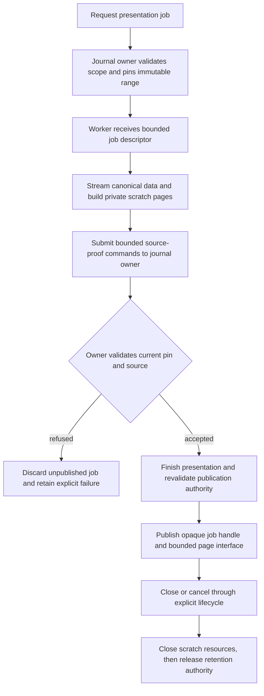

# Proposed asynchronous presentation ownership boundary

Status: **design proposal, not implemented**. This is a follow-up to the measured replay stalls, not a claim that the current experimental feature meets its responsiveness gate. Review the journal-owner contract before implementing it.

## Implemented intermediate slice

[Private conversation projection workers](native-conversation-scratch-worker.md) now move replay
scratch persistence and the complete historical index behind asynchronous leases. Canonical source
pin/proof transactions remain with the existing main-runtime owner. This reusable intermediate
slice does not implement the authoritative-owner migration proposed below or close the measured
responsiveness gate.

## Evidence and problem

The bounded replay implementation preserves exact canonical bytes, limits buffered projected rows, and substantially reduces transaction count. Its controlled 10,000-event run still failed tail-latency targets; see [performance checkpoints](native-conversation-performance-checkpoints.md).

A single separately labelled diagnostic reproduced a 809.61 ms heartbeat interval inside presentation building. It contained a 794.59 ms scratch transaction, including a 249.39 ms synchronous scratch `COMMIT`. Three other scratch commits exceeded 100 ms. Source pinning and source-proof transactions also took 147.87 ms and 176.15 ms. These observations identify blocking call sites, not their OS-level cause. Audit and paging were separate phases; simply making their chunks smaller does not address the observed commits.

Smaller replay batches cannot guarantee an upper bound on one synchronous database call. Disabling durable writes, dropping canonical evidence or reporting cancellation before it actually completes would change correctness rather than solve responsiveness.

## Options

| Option                                                                    | Benefit                                                                            | Limitation / decision                                                                                                                                        |
| ------------------------------------------------------------------------- | ---------------------------------------------------------------------------------- | ------------------------------------------------------------------------------------------------------------------------------------------------------------ |
| Current bounded synchronous batches                                       | Small, tested change; fewer commits; bounded collection; existing source authority | Implemented. Does not pass the observed tail-latency gate.                                                                                                   |
| Worker for private scratch replay only                                    | Moves scratch folding, commits and page serialization off the main event loop      | Useful intermediate work, but source pin/proof transactions remain synchronous; not a complete responsiveness solution.                                      |
| Worker-backed presentation plus serialized asynchronous journal ownership | Can keep main-loop request handling responsive while preserving one source owner   | Preferred architectural direction, subject to journal-owner review. Requires an explicit command protocol and migration plan, not a second competing writer. |
| Competing worker connection or relaxed source durability                  | Superficially reduces some waits                                                   | Reject. Violates or weakens ownership, transaction, retention or durability guarantees.                                                                      |

## Non-negotiable boundaries

1. `JournalHostDatabase` remains one logical owner with one authoritative source connection. Do not transfer its live synchronous handle between threads or silently introduce a foreign worker writer.
2. Preserve existing writer ordering, ownership/fence checks, FULL source commits and immutable pinned source ranges. Commands must execute as bounded synchronous transactions within their owner; never hold a source transaction across an await.
3. A presentation worker cannot authorize native dispatch, manufacture delivery receipts or grant source authority. Its pages are presentation, not canonical context evidence.
4. Source pin/proof writes and final publication checks remain journal-owned. A validated historical proof is not current permission after revocation, restart or ownership change.
5. Bound queued jobs, messages, projected rows and page bytes. Resource pressure must be explicit; do not silently truncate canonical history or add a hidden total-session limit.

## Suggested workflow

The exact source-read transport needs review: bounded messages, a verified immutable export or owner-mediated reads are alternatives. None should expose unrestricted filesystem paths or grant the worker an independent source-write connection. Reuse the project's lazy-worker lifecycle and existing page/capability boundaries where appropriate.

## Protocol and lifecycle requirements

- Use explicit domain commands rather than transferring executable closures. Include job identity, workspace/host scope, source epoch/range, generation and current ownership tokens as applicable; reject stale responses after job replacement.
- Preserve backpressure and queue fairness. Adding only an asynchronous facade over synchronous main-thread SQL does not move the blocking work.
- Source pin/proof commands need a reviewed asynchronous owner boundary. If other source writers remain synchronous, a worker-held transaction can still make a main-thread connection block on a lock; do not assume that two connections solve scheduling.
- Cancellation is requested, then acknowledged only after execution has stopped and cleanup is established. A worker blocked in I/O may not acknowledge immediately. Preserve uncertainty instead of claiming a successful cancel on a timeout.
- Worker death, a lost acknowledgment or a post-commit response failure must not cause a native send. Recover authoritative command state and retained pins before retrying metadata work; distinguish committed, rolled-back and unknown outcomes.
- Do not release a pin while cleanup still relies on its source. Preserve the existing retryable close/retention policy and clean orphan jobs only with positive ownership evidence.
- Return bounded pages and opaque handles. Keep scratch paths private; enforce current host/workspace authority on every externally reachable operation.

## Required proof before implementation is accepted

- Main event-loop responsiveness under injected slow source and scratch database calls, not just a faster median on one disk.
- Exact canonical and presentation hash/count parity with the synchronous implementation.
- FIFO ordering, clear/revocation/reopen races, worker death before/after commit, lost acknowledgment and stale-generation responses.
- Bounded queue/page memory, cleanup and retained-pin behavior under cancellation and process interruption.
- No duplicate native dispatch, tool replay or inferred delivery acceptance.
- Full relevant functional suites, worker packaging across supported platforms, remote capability compatibility and actual rendered behavior.

This proposal deliberately does not bypass the existing synchronous owner with an ad hoc worker connection. The current PR should remain draft while the outstanding acceptance gates and this broader ownership decision are unresolved.
